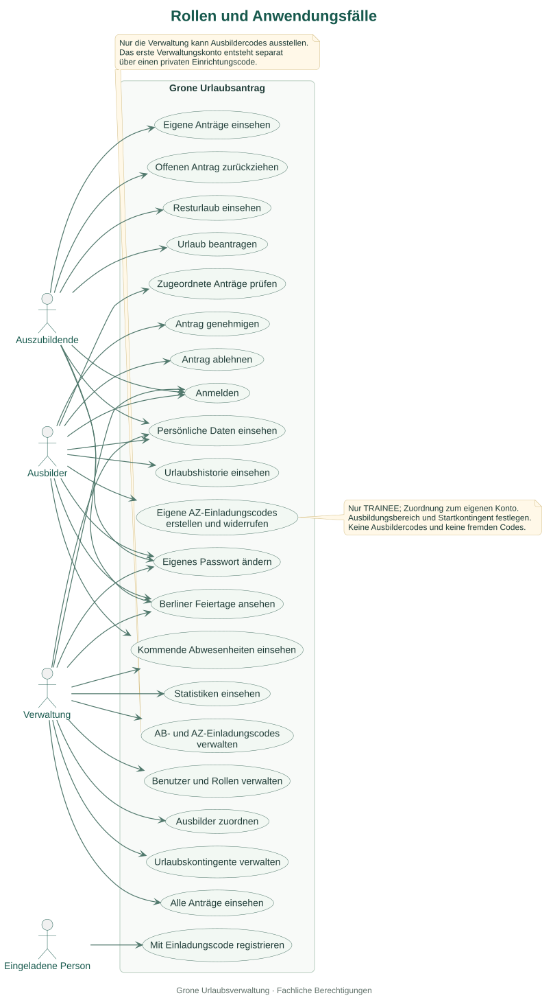
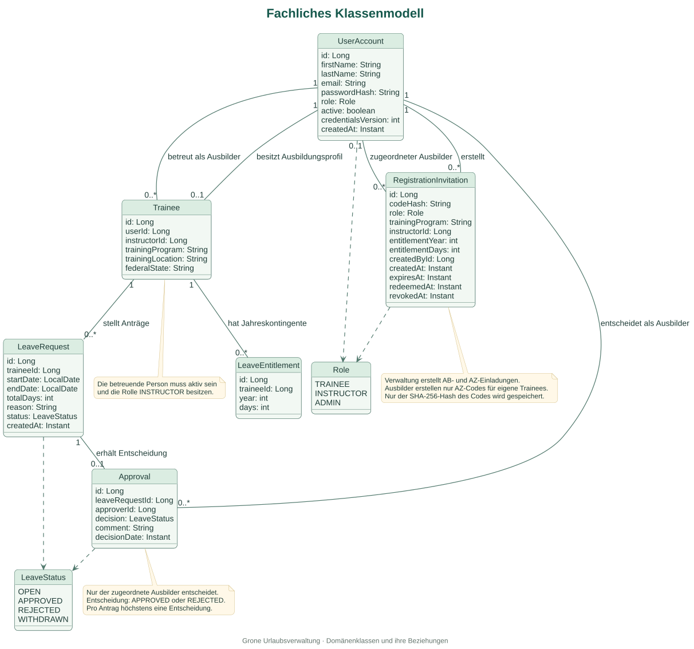
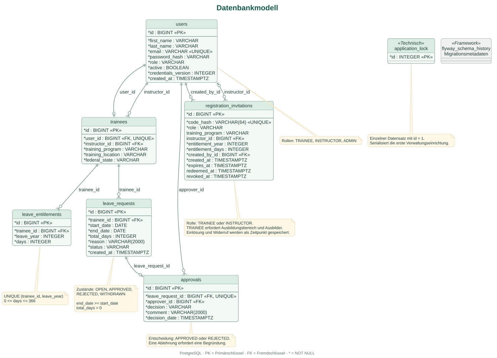
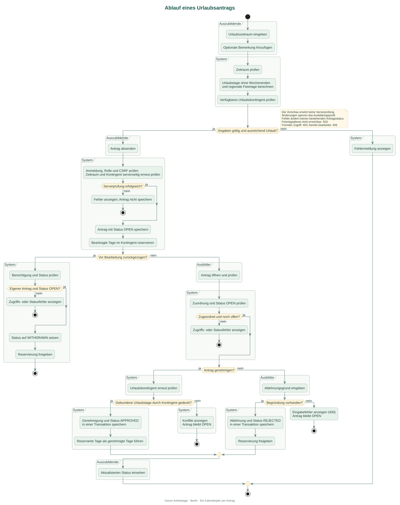
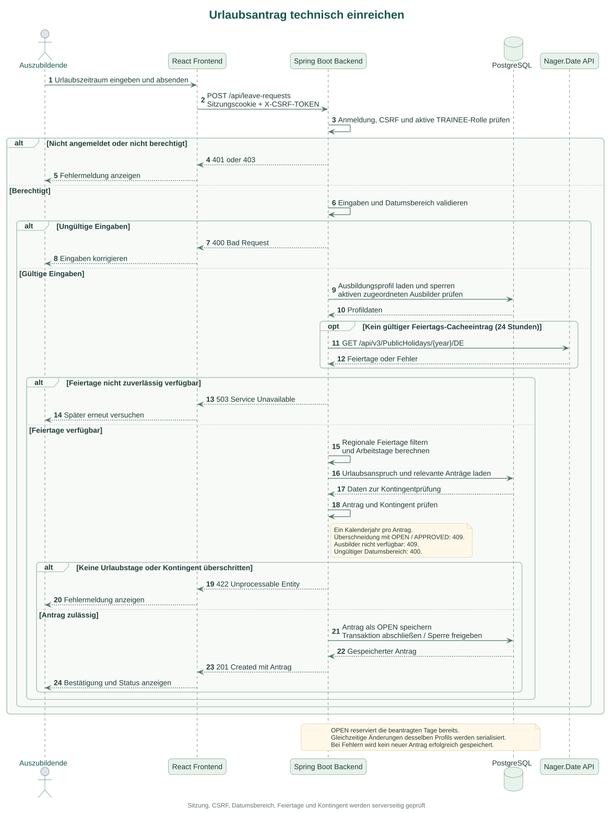
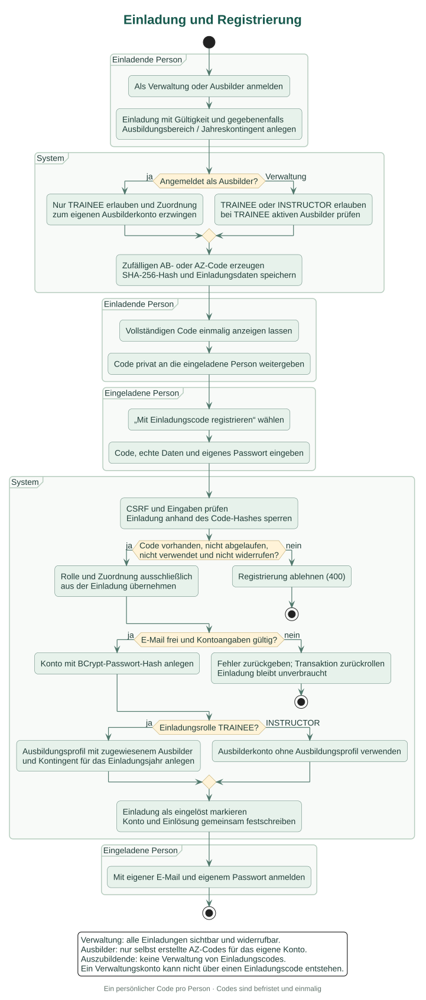
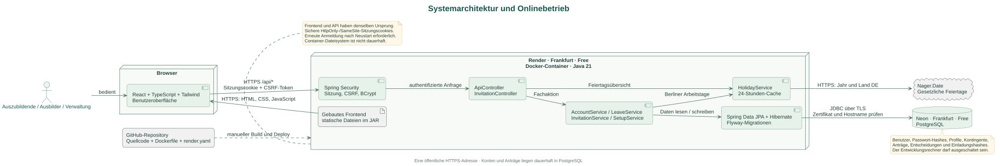
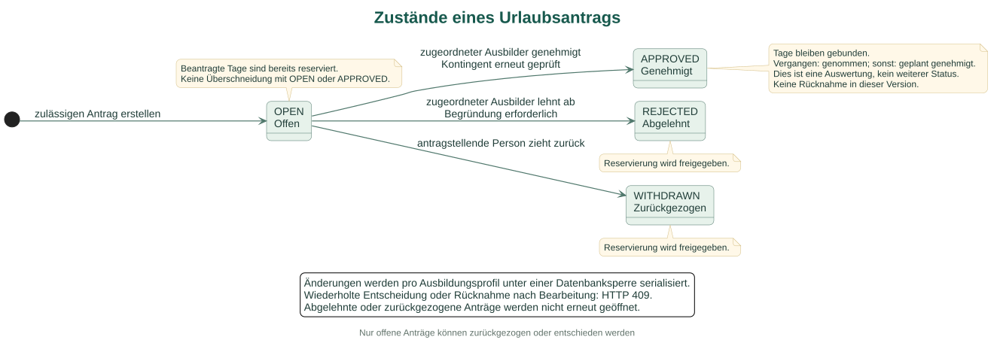

# Grafische Projektdiagramme

Alle Diagramme sind direkt hier auf GitHub sichtbar. Ein Klick auf die Grafik
öffnet die SVG-Datei zum Vergrößern. Zusätzlich steht jede Grafik als PNG zum
Herunterladen und Einfügen in Dokumente bereit. Es ist keine Erweiterung und
keine lokale Installation zum Ansehen erforderlich.

Die Diagramme beschreiben den implementierten Projektstand einschließlich
der Ausbilder-Einladungen für eigene Auszubildende und des Onlinebetriebs.

| Nr. | Diagramm | Inhalt | Download |
|---|---|---|---|
| 1 | [Anwendungsfälle](#1-rollen-und-anwendungsfälle) | Rollen und erlaubte Funktionen | [SVG](rendered/use-cases.svg) · [PNG](rendered/use-cases.png) |
| 2 | [Klassenmodell](#2-fachliches-klassenmodell) | Domänenklassen und Beziehungen | [SVG](rendered/classes.svg) · [PNG](rendered/classes.png) |
| 3 | [Datenbankmodell](#3-datenbankmodell) | Tabellen, Schlüssel und Kardinalitäten | [SVG](rendered/database.svg) · [PNG](rendered/database.png) |
| 4 | [Antragsablauf](#4-ablauf-eines-urlaubsantrags) | Einreichen, Entscheiden und Zurückziehen | [SVG](rendered/leave-request-activity.svg) · [PNG](rendered/leave-request-activity.png) |
| 5 | [Sequenzdiagramm](#5-technischer-ablauf-der-antragstellung) | Oberfläche, Backend, Datenbank und Feiertagsdienst | [SVG](rendered/leave-request-sequence.svg) · [PNG](rendered/leave-request-sequence.png) |
| 6 | [Einladung und Registrierung](#6-einladung-und-registrierung) | Einmalige Codes, Rollenzuweisung und Kontoanlage | [SVG](rendered/invitation-registration.svg) · [PNG](rendered/invitation-registration.png) |
| 7 | [Systemarchitektur](#7-systemarchitektur-und-onlinebetrieb) | Anwendung, Hosting und externe Dienste | [SVG](rendered/architecture.svg) · [PNG](rendered/architecture.png) |
| 8 | [Antragsstatus](#8-zustände-eines-urlaubsantrags) | Erlaubte Zustandswechsel und Kontingentbindung | [SVG](rendered/leave-request-states.svg) · [PNG](rendered/leave-request-states.png) |

## 1. Rollen und Anwendungsfälle

Die Verwaltung verwaltet alle Konten und Einladungen. Ausbilder entscheiden
zugeordnete Anträge und erstellen ausschließlich eigene Auszubildendencodes.
Auszubildende verwalten ihre eigenen Anträge. Die angezeigten Statistiken sind
die Kennzahlen der Übersichtsseite.

[](rendered/use-cases.svg)

[PlantUML-Quelle](use-cases.puml)

## 2. Fachliches Klassenmodell

Die Bezeichnungen entsprechen den Java-Domänenklassen. Beziehungen zeigen
das fachliche Modell; die Implementierung speichert die Verweise als IDs.

[](rendered/classes.svg)

[PlantUML-Quelle](classes.puml)

## 3. Datenbankmodell

Ein Stern markiert Pflichtfelder. Die Tabellenstruktur folgt den
[SQL-Migrationen](../../backend/src/main/resources/db/migration).
`application_lock` schützt die Ersteinrichtung; `flyway_schema_history`
wird vom Migrationsframework verwaltet und ist nur als technische Tabelle
angedeutet. Alle fachlichen Tabellen sind mit ihren Beziehungen dargestellt.

[](rendered/database.svg)

[PlantUML-Quelle](database.puml)

## 4. Ablauf eines Urlaubsantrags

Die Vorschau hilft bei der Eingabe. Beim Absenden prüft der Server erneut.
Offene Anträge reservieren bereits Urlaubstage; Ablehnen oder Zurückziehen
gibt diese frei.

[](rendered/leave-request-activity.svg)

[PlantUML-Quelle](leave-request-activity.puml)

## 5. Technischer Ablauf der Antragstellung

Das Sequenzdiagramm zeigt die API-Anfrage, den Feiertags-Cache, die gesperrte
Profilbearbeitung und zentrale Fehlerantworten. Ein Antrag umfasst genau ein
Kalenderjahr.

[](rendered/leave-request-sequence.svg)

[PlantUML-Quelle](leave-request-sequence.puml)

## 6. Einladung und Registrierung

Die Verwaltung erzeugt AB- und AZ-Codes. Ausbilder erzeugen AZ-Codes mit
festgelegter Zuordnung zu ihrem eigenen Konto. Rolle, Zuordnung und
Startkontingent werden bei der Registrierung aus der Einladung übernommen.

[](rendered/invitation-registration.svg)

[PlantUML-Quelle](invitation-registration.puml)

## 7. Systemarchitektur und Onlinebetrieb

Render liefert Oberfläche und API unter derselben HTTPS-Adresse aus. Neon
speichert die Daten dauerhaft. Der Rechner des Entwicklers muss dafür nicht
eingeschaltet sein.

[](rendered/architecture.svg)

[PlantUML-Quelle](architecture.puml)

## 8. Zustände eines Urlaubsantrags

Nach Genehmigung, Ablehnung oder Rücknahme wird ein Antrag nicht erneut
geöffnet. Genommener und zukünftig genehmigter Urlaub sind Auswertungen des
Zustands `APPROVED`.

[](rendered/leave-request-states.svg)

[PlantUML-Quelle](leave-request-states.puml)

## Grafiken aktualisieren

Die `.puml`-Dateien und die gemeinsame Gestaltung in `_style.iuml` sind die
bearbeitbaren Quellen. Nach einer Änderung im Projektverzeichnis ausführen:

```powershell
.\scripts\render-diagrams.ps1
```

Voraussetzung ist Java 21. Das Skript lädt beim ersten Aufruf die festgelegte
offizielle PlantUML-Version 1.2026.10 in das ignorierte Verzeichnis `.local/tools`,
prüft ihre SHA-256-Prüfsumme und exportiert alle Quellen lokal. Ein externer
Diagrammserver und Graphviz sind nicht nötig. Quellen und neu erzeugte Grafiken
gemeinsam committen. Generator-JAR und private Dateien werden nicht versioniert.
